<div align="center">

# BlackOut

**VTU-QFF-HC-0140** &nbsp;|&nbsp; Tier: **Online**

</div>

---

<div align="center">

| | |
| :--- | :--- |
| **Team** | BlackOut |
| **Team ID** | VTU-QFF-HC-0140 |
| **Tier** | Online |
| **Repository** | [vtu-hc-blackout](https://github.com/vtu-qiskit-fall-fest-2026/vtu-hc-blackout.git) |
| **Organisation** | [vtu-qiskit-fall-fest-2026](https://github.com/vtu-qiskit-fall-fest-2026) |
| **Event** | VTU-QFF Hackathon, VTU-Qiskit Fall Fest 2026 |

</div>

---

## 🧭 Overview

QuDock tests whether a quantum kernel can find BACE-1 inhibitors (a key Alzheimer's drug target)
better than classical machine learning when data is scarce and hardware is noisy. Molecules from
the MoleculeNet BACE dataset (1,513) are turned into fingerprints plus descriptors, compressed with
supervised PLS and loaded into a ZZ feature map. Fidelity, projected, hybrid (quantum + Tanimoto)
and trainable quantum kernels are compared with tuned classical models on identical features,
scaffold splits and seeds. The best quantum model, the hybrid kernel, reaches 0.776 ROC-AUC (up
from 0.687 in round one), within 0.006 of the best classical model (Random Forest, 0.782) but not
above it; on six reseeded splits classical stays ahead every time. Training the feature map is the
one significant quantum gain (+0.012, p = 0.03). A real run on ibm_marrakesh keeps the kernel's
shape (correlation 0.996 with the exact kernel), and the projected kernel cuts a full hardware run
from 92.5 hours to 7.6 minutes. In a simulated screening campaign, model-guided picking finds 85
more inhibitors in 250 tests than random picking.

**Demo video:** [watch on Google Drive](https://drive.google.com/file/d/17vJ5pzTXjhN4cXxzwQyV3GzaghxDYzhk/view?usp=sharing)

**Live web app:** [qudock-blackout.streamlit.app](https://qudock-blackout.streamlit.app/)

**Presentation:** [VTU-QFF-HC-0140.pptx](docs/VTU-QFF-HC-0140.pptx)

---

## 📌 Table of Contents

- [Overview](#-overview)
- [Team Members](#-team-members-github-ids)
- [Problem Statement](#-problem-statement)
- [Proposed Solution](#-proposed-solution)
- [Approach & Architecture](#-approach--architecture)
- [Results](#-results)
- [Demo](#-demo)
- [Tech Stack](#-tech-stack)
- [Project Structure](#-project-structure)
- [How to Run](#-how-to-run)
- [How to Push Code](#-how-to-push-code)
- [Submission Checklist](#-submission-checklist)
- [Resources](#-resources)
- [License](#-license)

---

## 👥 Team Members (GitHub IDs)

> Members are added to this repository as **collaborators** and must accept the
> GitHub invitation before they can push. Add your GitHub username below.

| # | Name | GitHub Username | Role |
| :-- | :--- | :--- | :--- |
| 1 | Shubhodeep Chatterjee | [@shubhodeepcx](https://github.com/shubhodeepcx) | Team Lead |
| 2 | Srijita Banerjee | [@srijita29-stack](https://github.com/srijita29-stack) | Developer |
| 3 | Rounak Pal | [@Rounak639](https://github.com/Rounak639) | Developer |

<!--
Optional: add a plain list instead of the table above.
- @username1
- @username2
-->

---

## ❓ Problem Statement

<!--
State the problem you are solving. Be specific: what is broken or missing,
who experiences it, and why does it matter. Link to the official problem
statement from the brief if one applies.
-->

**Problem:** Early-stage drug discovery involves screening thousands of molecules to identify compounds that can inhibit a specific target protein. However, obtaining experimentally measured activity data is expensive and time-consuming, meaning machine learning models often have to learn from limited labelled examples. Quantum machine learning, particularly quantum kernel methods, offers a potential approach by representing molecular data in quantum feature spaces that may capture complex patterns. However, claims that these methods learn more effectively from less data remain uncertain. Their performance must be evaluated against properly tuned classical models using realistic molecular data splits, while accounting for data leakage, computational costs, and quantum hardware noise.

**Why it matters:** β-secretase 1 (BACE-1) is an important enzyme studied as a potential therapeutic target in Alzheimer's disease research. Predicting molecular activity against BACE-1 provides a practical setting for evaluating quantum machine learning in drug discovery. This project will compare quantum kernel methods with classical models using molecular fingerprints, scaffold-based data splitting, and sample-efficiency experiments. It will also investigate how training data size, quantum circuit design, and hardware noise affect predictive performance. The goal is to determine whether quantum kernels offer a measurable advantage over classical approaches in data-limited virtual screening and whether that advantage, if present, remains meaningful under realistic conditions.

**Track / Category:** Online · Quantum machine learning · Drug discovery

---

## 💡 Proposed Solution

<!--
Describe your solution. Keep it concrete: the core idea, the user flow, and
the quantum/ML technique you are applying.
-->

**Solution:** We built **QuDock**, a hybrid quantum and classical pipeline that predicts whether
a molecule inhibits BACE-1. Molecular fingerprints are compressed and loaded into a ZZ feature
map, and a quantum kernel SVM (QSVC) is trained on the result. We compare it with SVM-RBF,
Random Forest and Logistic Regression on the same features, with 25 to 1,210 training
molecules, 2 to 10 qubits, with simulated IBM device noise, and on a real IBM quantum computer.

**Key idea:** Use the fidelity kernel $k(x, y) = |\langle\phi(x)|\phi(y)\rangle|^2$ of a ZZ
feature map, and test it with a fair benchmark plus a few checks on the kernel itself
(geometric difference, kernel-target alignment and concentration).

**Why this works:** All models get exactly the same features. The data is split by molecular
scaffold, so the test set contains molecule families the models have never seen.
Hyperparameters are tuned with cross-validation, and every result is averaged over several
seeds and checked with a paired significance test. So if quantum and classical results differ,
it is because of the models and not because of how we set up the comparison.

---

## 🧩 Approach & Architecture

<!--
Walk through how it works. A simple pipeline diagram in text or Mermaid is ideal.
-->

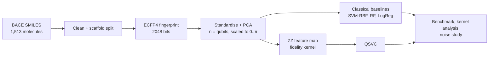

1. **Input:** the MoleculeNet BACE dataset, 1,513 SMILES strings, each labelled as inhibitor or
   non-inhibitor (`qudock.data`).
2. **Preprocessing:** we canonicalise the SMILES, drop molecules that can't be parsed or have
   conflicting labels, and split by Bemis-Murcko scaffold (1,210 train, 303 test). Each molecule
   becomes a Morgan (ECFP4) fingerprint, which is standardised, reduced with PCA to one value per
   qubit and rescaled to [0, π]. All of this is fit on the training data only
   (`qudock.features`).
3. **Quantum core:** a ZZFeatureMap with linear entanglement, 1 or 2 reps and a tunable
   bandwidth. For the benchmark the kernel is computed exactly from statevectors (and cached).
   For the noise study it is estimated from compute-uncompute circuits with a finite number of
   shots on AerSimulator, with and without the FakeTorino noise model. Finally, the same
   circuits for 12 molecules are run on a real IBM device, ibm_marrakesh (`qudock.quantum`,
   `qudock.noise`, `qudock.hardware`).
4. **Post-processing:** an SVM is trained on the precomputed kernel, with C and bandwidth chosen
   by stratified inner cross-validation. Noisy kernels can optionally be repaired to the nearest
   positive semi-definite (PSD) matrix.
5. **Output:** test ROC-AUC, accuracy, F1 and MCC for each model, training size and seed,
   Wilcoxon tests of QSVC against the best classical model, kernel diagnostics, and figures in
   `results/full/`.

---

## 📊 Results

All numbers are test ROC-AUC on the scaffold split. The full tables and figures are in
[`results/full/`](results/full), and the [demo notebook](notebooks/demo.ipynb) goes through them
step by step.

**Sample efficiency** (6 qubits, average of 5 seeds):

| Training molecules | QSVC | SVM-RBF | Random Forest | Logistic Regression |
| --: | --: | --: | --: | --: |
| 25 | 0.592 | 0.644 | 0.625 | 0.623 |
| 50 | 0.588 | 0.653 | 0.640 | 0.594 |
| 100 | 0.649 | 0.666 | 0.700 | 0.573 |
| 200 | 0.673 | 0.692 | 0.704 | 0.593 |
| 400 | 0.688 | 0.703 | 0.723 | 0.596 |
| 1,210 | 0.687 | 0.683 | 0.740 | 0.607 |

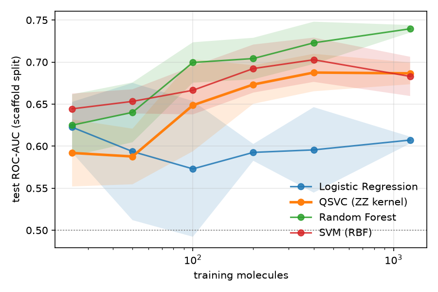

**Qubit sweep** (full training set, average of 3 seeds): QSVC does best with 8 qubits, at 0.719.
That is better than SVM-RBF (0.705) and Logistic Regression (0.626) but still below Random
Forest (0.729).

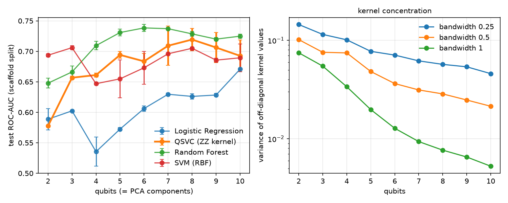

**Noise study** (4 qubits, 80 train and 40 test molecules, 3 seeds, simulated IBM Torino):
here each kernel entry is estimated from measurement shots, with and without the noise model of
the FakeTorino device. Circuits are transpiled at optimization level 3, so they sit on well
chosen qubits, as on a real device. Each cell shows relative kernel error / test ROC-AUC, using
the raw kernel without PSD repair.

| Setting | reps = 1 | reps = 2 |
| :-- | --: | --: |
| Exact kernel | 0.000 / 0.650 | 0.000 / 0.626 |
| Shots only, 256 | 0.055 / 0.616 | 0.064 / 0.628 |
| Shots only, 1024 | 0.027 / 0.649 | 0.032 / 0.622 |
| Shots only, 4096 | 0.014 / 0.639 | 0.016 / 0.623 |
| FakeTorino, 256 | 0.096 / 0.633 | 0.132 / 0.631 |
| FakeTorino, 1024 | 0.082 / 0.659 | 0.119 / 0.644 |
| FakeTorino, 4096 | 0.078 / 0.640 | 0.115 / 0.633 |

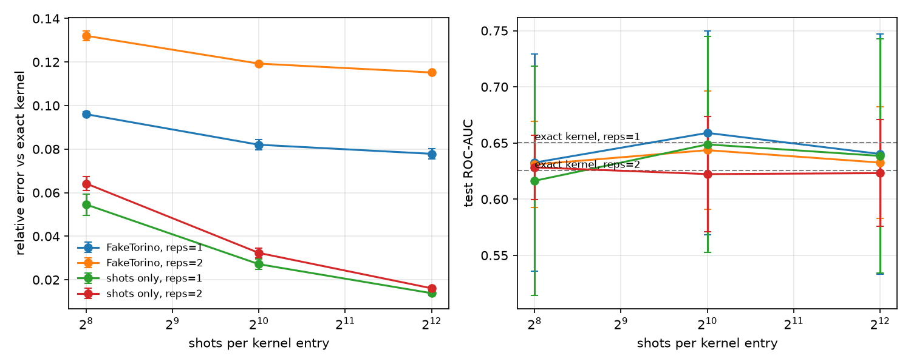

**Real IBM quantum computer** (ibm_marrakesh, 12 training-set molecules with 6 inhibitors, 4 qubits,
reps = 2, 66 circuits at 1,024 shots in one job, 20 seconds of quantum time): we measured the
kernel on the device and compared it with the exact kernel and with FakeTorino simulating the
same circuits.

| Kernel | Relative error vs exact | Mean off-diagonal value | Correlation with exact |
| :-- | --: | --: | --: |
| Exact | 0.000 | 0.262 | 1.000 |
| FakeTorino simulation | 0.103 | 0.238 | 0.999 |
| ibm_marrakesh (real device) | 0.175 | 0.218 | 0.996 |

Details, including the job ID, are in [`results/hardware/`](results/hardware).

**What we learned**

- QSVC does about as well as an RBF SVM on the same features and beats Logistic Regression
  from 100 molecules up, but it never beats Random Forest. It is 0.03 to 0.07 ROC-AUC behind
  the best classical model at every training size. With only 5 seeds none of these gaps is
  statistically significant (the smallest possible Wilcoxon p-value is 0.06).
- We found no advantage with little data. With 25 or 50 training molecules QSVC is actually the
  weakest model.
- The quantum kernel is very different from the RBF kernel (geometric difference up to about
  100), and at bandwidth 0.5 it lines up better with the labels (alignment 0.15 to 0.18, against
  0.09 to 0.10 for RBF). That didn't lead to better predictions on this dataset.
- Kernel concentration shows up clearly. At bandwidth 1.0 the variance of the off-diagonal
  kernel values falls from 0.075 at 2 qubits to 0.005 at 10 qubits, so the bandwidth has to be
  tuned.
- Device noise changes the kernel more than shot noise does. Simulated Torino noise causes 8 to
  13% error that more shots don't fix, while shot noise alone causes 1.4 to 6.4%. Even so, test
  ROC-AUC stays between 0.62 and 0.66 in every setting, and with the variation between seeds
  (about 0.05 to 0.10) we can't measure a difference at this sample size. Repairing the noisy
  kernel to be PSD makes almost no difference.
- The real device is noisier than the simulation (17.5% kernel error against 10.3% for
  FakeTorino on the same molecules), but the kernel keeps its shape: its values correlate 0.996
  with the exact kernel. The noise mostly shrinks every value a little, which is why the SVM's
  ranking of molecules, and so its accuracy, barely changes.
- Our first noise study placed circuits on poorly chosen qubits and reported 25 to 28% error.
  Checking it against the real device exposed this, and the numbers above are from the
  corrected run.

### Final round: can a better-fed or hybrid quantum kernel close the gap?

For the final round we went after the two weak points above: the quantum kernel only ever saw
6 unsupervised PCA numbers, and the bandwidth was fixed by hand. Every model below runs on the
same scaffold split, the same training sizes and the same 10 seeds
(`qudock final --out results/final`, under an hour on a laptop CPU). Besides ROC-AUC we now
report screening metrics: enrichment of inhibitors in the top 1% and 5% of the ranking, BEDROC
and PR-AUC. All files are in [`results/final/`](results/final).

What we added:

- **Supervised compression:** PLS on the fingerprint plus 10 RDKit descriptors (weight, logP,
  TPSA, H-bond donors and acceptors and so on) instead of PCA, so the 6 qubits get the
  directions that matter for activity.
- **Adaptive bandwidth:** chosen per run by kernel-target alignment on the training set only.
  This is our answer to kernel concentration, and it picks 0.19 to 0.30 for PLS features and
  0.55 to 0.80 for PCA features.
- **Projected quantum kernel** (Huang et al., 2021): each molecule's single-qubit X, Y and Z
  expectations go into an RBF kernel. It needs one circuit per molecule instead of one per pair,
  which is what makes a full classifier on real hardware affordable.
- **Hybrid kernel:** w x quantum + (1 - w) x Tanimoto on the full fingerprint, with w chosen by
  inner cross-validation.
- **Fair baselines:** SVM-RBF and Random Forest on exactly the same PLS features, and Tanimoto SVM
  and Random Forest on the full 2,048-bit fingerprint, which is the classical ceiling.

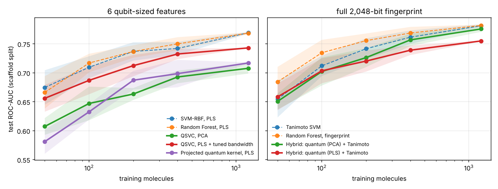

**Mean test ROC-AUC over 10 seeds** (6 qubits):

| Training molecules | QSVC, PCA | QSVC, PLS + tuned bw | Projected, PLS | SVM-RBF, PLS | RF, PLS | Hybrid, PCA | Tanimoto SVM | RF, fingerprint |
| --: | --: | --: | --: | --: | --: | --: | --: | --: |
| 50 | 0.607 | 0.656 | 0.581 | 0.675 | 0.666 | 0.651 | 0.655 | 0.684 |
| 100 | 0.647 | 0.687 | 0.633 | 0.710 | 0.717 | 0.702 | 0.712 | 0.735 |
| 200 | 0.663 | 0.712 | 0.687 | 0.737 | 0.737 | 0.726 | 0.742 | 0.756 |
| 400 | 0.693 | 0.732 | 0.699 | 0.742 | 0.750 | 0.757 | 0.762 | 0.769 |
| 1,210 | 0.708 | 0.743 | 0.717 | 0.769 | 0.768 | 0.776 | 0.781 | 0.782 |

**Paired bootstrap on the full-size test set** (2,000 resamples of the same test molecules):

| Comparison | ROC-AUC difference | 95% interval | p |
| :-- | --: | --: | --: |
| QSVC PLS vs QSVC PCA | +0.046 | -0.015 to 0.106 | 0.15 |
| QSVC PLS vs SVM-RBF PCA (first-round baseline) | +0.102 | 0.033 to 0.170 | <0.001 |
| QSVC PLS vs SVM-RBF PLS (same features) | -0.026 | -0.050 to -0.002 | 0.03 |
| QSVC PLS vs RF PLS (same features) | -0.024 | -0.049 to 0.001 | 0.06 |
| Hybrid PCA vs Tanimoto SVM | -0.020 | -0.054 to 0.013 | 0.27 |

**What we learned in the final round**

- Better features and a tuned bandwidth lift QSVC by 0.035 to 0.049 ROC-AUC at every training
  size, and it now clearly beats the first-round SVM-RBF baseline (p < 0.001).
- Most of that gain comes from the features, not from the quantum kernel. On the very same PLS
  features, SVM-RBF and Random Forest still do 0.01 to 0.03 better at every size, and the difference against
  SVM-RBF is significant (p = 0.03). We report this rather than the flattering comparison.
- The hybrid kernel keeps a real quantum share (inner CV picks w between 0.1 and 0.5) and
  reaches 0.776, within 0.006 of the best classical model, but it does not beat Tanimoto SVM
  (p = 0.27). The quantum part adds information without hurting, but not enough to win.
- With PLS inside the hybrid, inner CV overrates the quantum part, because PLS has already seen
  the training labels. The PCA hybrid has no such leak and does better (0.776 against 0.755).
- The projected kernel is slightly weaker than the fidelity kernel here, but it is the one we
  can run as a full classifier on hardware (`qudock hardware-svm`).

### Does it survive more qubits? (`qudock scaling`)

The judges asked how we keep classes separable as qubits grow, since quantum kernels concentrate:
every pair of molecules looks equally distant, and the SVM has nothing left to learn from. We
measured it directly from 4 to 14 qubits on the same 400 molecules, reporting the spread
(standard deviation) of the off-diagonal kernel values next to test ROC-AUC.

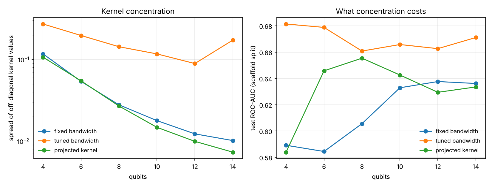

| Qubits | Spread, fixed bandwidth | Spread, tuned | ROC-AUC, fixed | ROC-AUC, tuned | ROC-AUC, projected |
| --: | --: | --: | --: | --: | --: |
| 4 | 0.117 | 0.273 | 0.589 | 0.681 | 0.584 |
| 6 | 0.054 | 0.197 | 0.584 | 0.679 | 0.646 |
| 8 | 0.028 | 0.144 | 0.606 | 0.661 | 0.655 |
| 10 | 0.018 | 0.117 | 0.633 | 0.666 | 0.643 |
| 12 | 0.012 | 0.089 | 0.638 | 0.663 | 0.629 |
| 14 | 0.010 | 0.173 | 0.636 | 0.671 | 0.634 |

At a fixed bandwidth the kernel does concentrate: the spread falls by a factor of 11 between 4
and 14 qubits. Tuning the bandwidth by kernel-target alignment keeps it 9 to 17 times larger,
and that shows up as 0.03 to 0.09 more ROC-AUC at every width. The alignment picks 0.2 at 4 to
12 qubits and 0.1 at 14, which is the adaptive scaling the question was about. The projected
kernel concentrates as much as the plain one by this measure, because it is the RBF on top, not
the overlap, that keeps it usable.

### Does it hold on another task? (`qudock final --dataset bbbp`)

A method tuned until it works on one dataset proves little, so we ran the same pipeline,
unchanged, on MoleculeNet BBBP: can a molecule cross the blood-brain barrier, which every
Alzheimer's drug has to do. 1,965 molecules, the same scaffold split, 5 seeds.

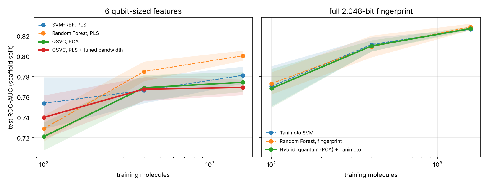

| Training molecules | QSVC, PLS | SVM-RBF, PLS | RF, PLS | Hybrid, PCA | Tanimoto SVM | RF, fingerprint |
| --: | --: | --: | --: | --: | --: | --: |
| 100 | 0.740 | 0.754 | 0.729 | 0.768 | 0.770 | 0.773 |
| 400 | 0.768 | 0.766 | 0.785 | 0.810 | 0.811 | 0.809 |
| 1,572 | 0.769 | 0.781 | 0.800 | 0.827 | 0.826 | 0.829 |

The BACE story repeats: the hybrid kernel is level with the best classical model (0.827 against
0.826 and 0.829, differences of 0.002 to 0.004 with p = 0.68 and 0.72, so no measurable gap),
while the quantum kernel alone stays behind Random Forest on the same features (-0.027,
p = 0.02). Two datasets, same conclusion.

### Does training the feature map help? (`qudock trainable`)

The ZZ map is fixed: the only thing we could tune was one global bandwidth. So we made the map
itself trainable, the way Hubregtsen et al. (2022) propose: every encoding angle gets its own
weight, every qubit a trainable rotation, and the parameters are chosen by maximising
kernel-target alignment on the training set, with no SVM fits and no test data. With all weights
at one and no rotation the circuit is exactly the ZZ map, so the fixed map is the starting point
of the search and any gain belongs to the training.

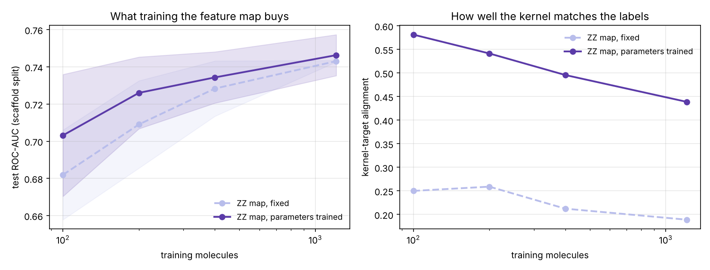

| Training molecules | ROC-AUC, fixed | ROC-AUC, trained | Alignment, fixed | Alignment, trained |
| --: | --: | --: | --: | --: |
| 100 | 0.682 | 0.703 | 0.25 | 0.58 |
| 200 | 0.709 | 0.726 | 0.26 | 0.54 |
| 400 | 0.728 | 0.734 | 0.21 | 0.50 |
| 1,210 | 0.743 | 0.746 | 0.19 | 0.44 |

Training more than doubles the alignment and wins 14 of 20 runs, +0.012 ROC-AUC on average
(Wilcoxon p = 0.03), and it costs about 12 seconds per run on a laptop CPU. The gain is largest
with little data (+0.021 at 100 molecules), which is the regime drug discovery starts in.

Two honest caveats. The trained kernel scores about 0.98 in cross-validation on the training
molecules but only 0.75 on the test set: it learns the training chemistry very well and
transfers a little of that to unseen scaffolds. And in the hybrid kernel at full size, any
quantum weight above zero still costs accuracy (0.784 at weight 0 against 0.743 at weight 1),
trained or not. Training the map makes the quantum kernel better; it does not make it the best
model here.

### How much can you trust one prediction? (`qudock confidence`)

A screening model is only useful if it says when it does not know. We added conformal
prediction, which turns a score into a set of labels: {inhibitor}, {not an inhibitor}, both
("don't know") or neither. Its guarantee assumes new molecules resemble the calibration ones,
so we calibrate on the rarest training scaffolds, the way the test set was built, and then
measure whether the promise holds.

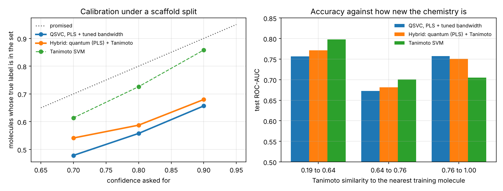

| Model | Asked for 90% | Measured | Single-label predictions | Right when it commits |
| :-- | --: | --: | --: | --: |
| QSVC, PLS | 0.90 | 0.657 | 0.911 | 0.721 |
| Hybrid, PLS | 0.90 | 0.680 | 0.957 | 0.710 |
| Tanimoto SVM | 0.90 | 0.858 | 0.571 | 0.751 |

Asking for 90% confidence really delivers 66 to 86% under a scaffold split. That is not a bug in
the method: it is what happens when test molecules are genuinely new chemistry, and it is worth
reporting, because a confidence number taken from a random split would have looked fine and
been wrong. Accuracy tracks the same thing: on the third of test molecules least similar to the
training set, every model loses 0.05 to 0.10 ROC-AUC. The app shows this similarity for each
molecule you screen.

#### Can the shortfall be fixed? We tried, and it cannot

The standard correction for this situation is weighted conformal prediction (Tibshirani et al.,
2019): count each calibration molecule in proportion to how chemically similar it is to the one
being predicted, which is a proxy for the likelihood ratio under covariate shift. We implemented
it (`ConformalClassifier(..., similarity_bandwidth=h)`) and measured it rather than assuming it
helps.

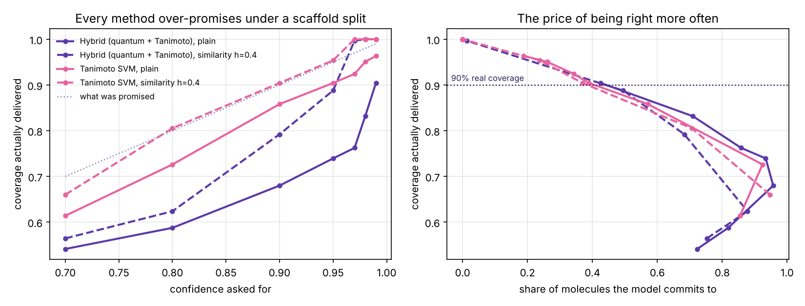

| Method | Ask for | Real coverage | Commits to a label |
| :-- | --: | --: | --: |
| Hybrid, plain calibration | 0.99 | 0.904 | 0.426 |
| Hybrid, similarity-weighted | 0.97 | 0.997 | 0.013 |
| Tanimoto SVM, plain | 0.95 | 0.904 | 0.389 |
| Tanimoto SVM, similarity-weighted | 0.90 | 0.904 | 0.370 |

Weighting does raise coverage at any requested confidence, but only by refusing to commit: for
the hybrid kernel it goes from 96% single-label predictions to 68% at the 90% setting, and past
0.97 it answers "don't know" for everything. The right panel above is the point: plotted against
how often the model actually commits, all four curves fall on the same line. The weighting moves
you along that curve; it does not lift it.

So the honest conclusion is that under scaffold shift there is no free lunch in calibration. If
you need 90% real coverage on new chemistry, you must ask for about 98% and accept a "don't
know" on a third to a half of molecules. That is a usable instruction for a screening team, and
it is more useful than a method that looks calibrated because it never commits.

### Which atoms drove the prediction? (`qudock explain`)

A kernel SVM has no coefficients to read: its decision value is a sum over training molecules,
not over features. So we ask the model instead of opening it. Each fingerprint bit stands for
one substructure; we switch that bit off, push the molecule back through the same compression
and the same quantum kernel, and record how far the score moves. Every bit knows the atoms whose
environment set it, so the movement lands on atoms, and the molecule can be drawn with them
highlighted: green for atoms arguing inhibitor, purple for atoms arguing against.

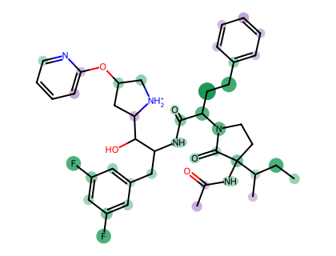

An explanation nobody checked is decoration, so we checked it. For the 24 test molecules the
model is most sure about, we removed the top fifth of atoms by attribution and, as a control,
as many atoms picked at random.

| | Score lost | Fingerprint bits broken |
| :-- | --: | --: |
| Highlighted atoms | 0.563 | 25.8 |
| Random atoms | 0.381 | 34.0 |

The highlighted atoms cost the model more than twice as much score per bit they break, and win
the comparison on 18 of 24 molecules. The six that lose are the largest molecules, where removing
any fifth breaks enough of the fingerprint to move the score on its own.

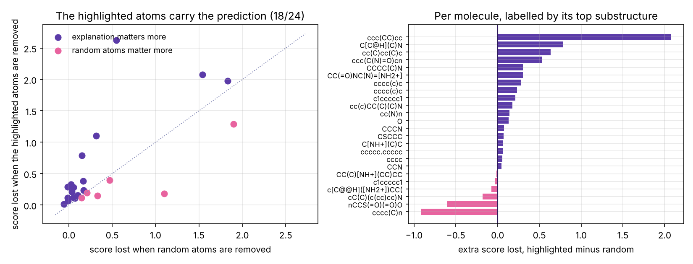

One extra decision value per bit is needed, about fifty per molecule, so an explanation takes
roughly a fifth of a second at 6 qubits. The app runs it live on whatever molecule you paste.

### The scorecard (`qudock scorecard`)

Every setting we measured, in one chart: the best quantum-containing model against the best
purely classical model on the same molecules, with a 95% interval over seeds. It is built from
the result files, so it cannot drift from the experiments.

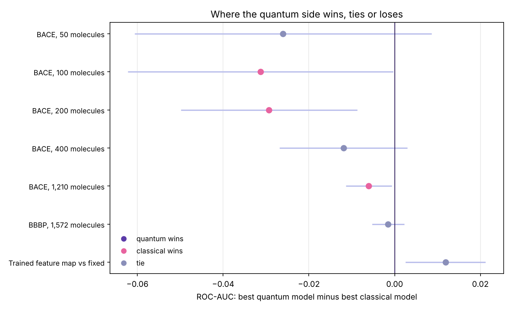

| Setting | Best quantum | Best classical | Difference | Verdict |
| :-- | --: | --: | --: | :-- |
| BACE, 50 molecules | 0.658 | 0.684 | -0.026 | tie |
| BACE, 100 molecules | 0.703 | 0.735 | -0.031 | classical wins |
| BACE, 200 molecules | 0.726 | 0.756 | -0.029 | classical wins |
| BACE, 400 molecules | 0.757 | 0.769 | -0.012 | tie |
| BACE, 1,210 molecules | 0.776 | 0.782 | -0.006 | classical wins |
| BBBP, 1,572 molecules | 0.827 | 0.829 | -0.002 | tie |
| Trained vs fixed feature map | 0.727 | 0.716 | +0.012 | quantum wins |

The gap closes as the quantum side gets better features, a tuned bandwidth, a hybrid kernel and
a trained feature map: from -0.031 to -0.002. It has not crossed zero. That is our result, and
we would rather show the chart than hide it.

### Does the answer depend on the split we chose? (`qudock robustness`)

Every number above rests on one Bemis-Murcko scaffold split. That is the standard protocol, but
it means one arbitrary choice of which rare scaffolds to hold out sits underneath every claim. So
we reseeded it: crowded scaffolds stay in training, but which rare ones are held out changes,
which swaps about a third of the test set each time. Five reseeded splits, plus the fixed one,
same models, same inner cross-validation.

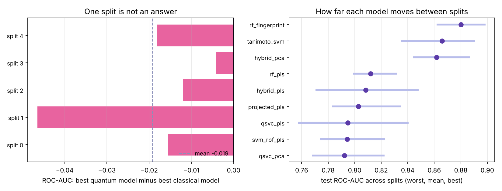

| Split | Best quantum | Best classical | Difference |
| :-- | --: | --: | --: |
| fixed (used everywhere else) | 0.778 | 0.787 | -0.008 |
| reseeded 0 | 0.870 | 0.886 | -0.015 |
| reseeded 1 | 0.844 | 0.891 | -0.046 |
| reseeded 2 | 0.887 | 0.899 | -0.012 |
| reseeded 3 | 0.858 | 0.862 | -0.004 |
| reseeded 4 | 0.851 | 0.869 | -0.018 |

The conclusion survives: the hybrid kernel is behind on every split, by -0.004 to -0.046, and the
fixed split we have been quoting is not an outlier. Compared split by split it is level with the
Tanimoto SVM (-0.004, 95% interval -0.027 to +0.019, ahead on three splits of five) and behind
the Random Forest on fingerprints (-0.018, -0.031 to -0.006).

What moves most is the split itself. A model's ROC-AUC shifts by 0.02 to 0.04 between splits and
by 0.0001 to 0.008 between seeds within one split, so split choice is five to twenty times the
noise that seed averaging removes. Any paper that reports one scaffold split, ours included until
now, is quoting a number with a 0.04 wobble that its error bars do not show.

### Does it work as a screening campaign? (`qudock campaign`)

A benchmark hands a model a fixed training set. A screening team tests a few compounds, retrains
on what comes back, and picks the next few. We simulated that loop on BACE: start from 50
molecules, test 25 per round for 8 rounds, and count the inhibitors found by the time the budget
runs out. Labels come from the measurements, so nothing is invented, and the held-out scaffold
test set is never in the pool.

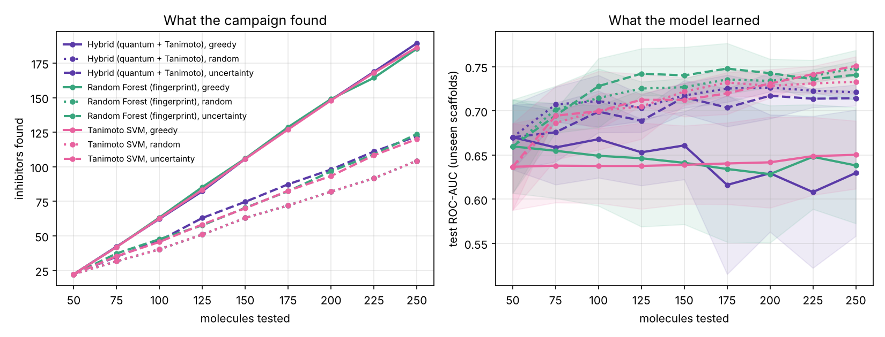

| Model and strategy | Inhibitors found in 250 | Hit rate | Final test ROC-AUC |
| :-- | --: | --: | --: |
| Hybrid quantum, greedy | 189 | 0.76 | 0.630 |
| Tanimoto SVM, greedy | 186 | 0.75 | 0.650 |
| Random Forest, greedy | 185 | 0.74 | 0.638 |
| Tanimoto SVM, mixed | 159 | 0.64 | 0.722 |
| Random Forest, mixed | 158 | 0.63 | 0.736 |
| Hybrid quantum, mixed | 149 | 0.60 | 0.720 |
| Random Forest, uncertainty | 124 | 0.49 | 0.741 |
| Tanimoto SVM, uncertainty | 120 | 0.48 | 0.751 |
| Any model, random | 104 | 0.42 | 0.73 to 0.75 |

The headline is not quantum against classical. It is that **a guided campaign finds 85 more
inhibitors than random screening on the same budget**, nearly doubling the hit rate, which is the
number a drug discovery team would act on. Within that, the hybrid quantum kernel came first on
all three seeds, by 3 molecules out of 189, which is real but small.

The strategies trade off exactly as theory says they should, and nobody told the models to:
greedy picking finds the most inhibitors and learns the least (0.63 final ROC-AUC), uncertainty
sampling finds the fewest and learns the most (0.75). Splitting each batch half and half lands
where you would hope: 85% of the hits greedy finds, with a model as good as the one pure
uncertainty sampling builds (0.72 to 0.74). If a team has to keep screening next quarter too,
that is the setting to run.

### What would it cost on a real device? (`qudock cost`)

Accuracy tables leave out half of the question. A fidelity kernel needs one circuit per pair of
molecules, so training on 1,210 and scoring 303 takes 1,099,285 circuits. Our own hardware job
ran 66 circuits at 1,024 shots in 20 seconds of quantum time, which is 0.30 s per circuit, and
that measured rate is what the device column below uses.

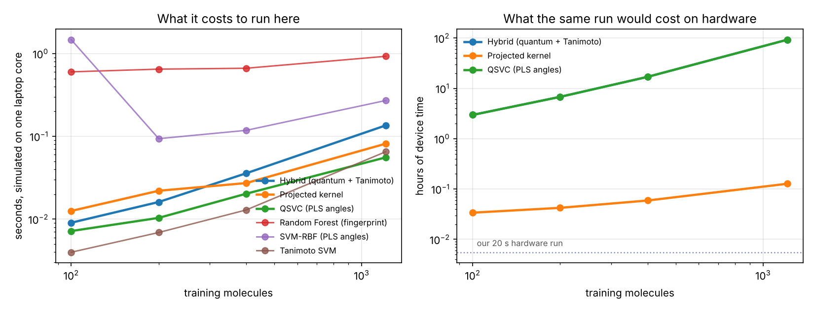

| Model | Test ROC-AUC | Seconds, simulated | Circuits | Device time at our measured rate |
| :-- | --: | --: | --: | --: |
| Tanimoto SVM | 0.793 | 0.07 | 0 | none |
| Random Forest (fingerprint) | 0.781 | 0.93 | 0 | none |
| SVM-RBF (PLS angles) | 0.770 | 0.27 | 0 | none |
| Hybrid (quantum + Tanimoto) | 0.761 | 0.14 | 1,099,285 | 92.5 hours |
| Projected kernel | 0.750 | 0.08 | 1,513 | 7.6 minutes |
| QSVC (PLS angles) | 0.743 | 0.06 | 1,099,285 | 92.5 hours |

Simulated, everything here is under a second. On hardware, the fidelity kernel is the model that
scores lowest and costs 92 hours, while the projected kernel needs one circuit per molecule
instead of one per pair, so it is 700 times cheaper and only 0.011 ROC-AUC behind it. If any of
this is ever run for real, that is the design to run.

### Does putting chemistry into the circuit help? (`qudock graph`)

The ZZ map entangles neighbouring qubits in an arbitrary order on compressed fingerprint
angles. Here each qubit is a pharmacophore family (donor, acceptor, positive and negative
ionizable, aromatic, hydrophobe), and every pair of qubits is entangled in proportion to how
close those groups sit in the molecule, so the entanglement pattern follows each molecule's
own structure. The fair comparison is against classical models on exactly the same 21 numbers.

| Training molecules | Graph quantum kernel | SVM-RBF, same numbers | Random Forest, same numbers | ZZ map on PLS |
| --: | --: | --: | --: | --: |
| 100 | 0.648 | 0.663 | 0.680 | 0.680 |
| 400 | 0.673 | 0.666 | 0.716 | 0.725 |
| 1,210 | 0.656 | 0.682 | 0.745 | 0.743 |

The structured map ties the RBF kernel on the same information and loses to a Random Forest.
Twenty-one interpretable pharmacophore numbers are enough for a Random Forest to match the
best fingerprint models (0.745), but the quantum kernel does not add anything on top of them.

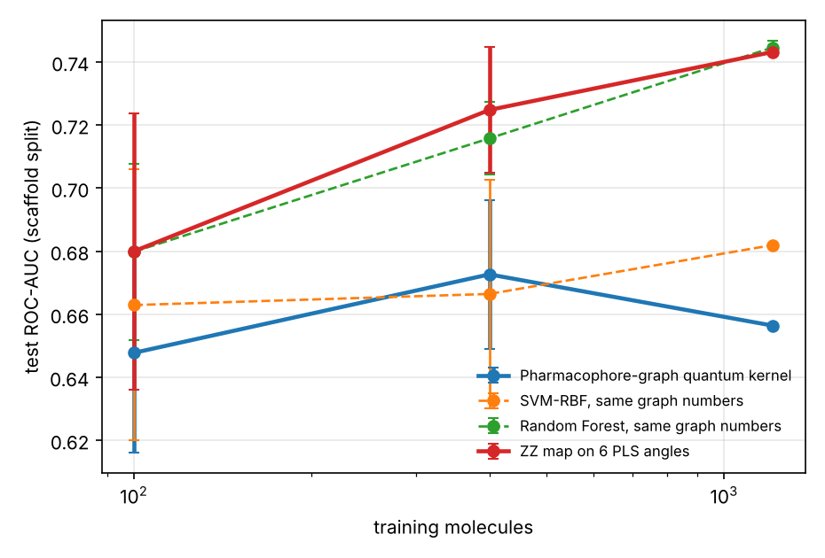

### Ranking for an Alzheimer's project (`qudock screen`)

A BACE-1 hit only matters if it also reaches the brain and looks like a drug. `qudock screen`
gives every molecule a calibrated activity p-value from the hybrid quantum + Tanimoto model,
the probability of crossing the blood-brain barrier (Random Forest trained on BBBP), RDKit's
QED, PAINS alerts and an applicability-domain flag, and ranks by a weighted geometric mean.

Checked on the BACE scaffold test set, where the activity labels are known:

| Ranking by | ROC-AUC | PR-AUC | BEDROC |
| :-- | --: | --: | --: |
| Activity score only | 0.739 | 0.774 | 0.849 |
| Combined (activity x BBB x QED) | 0.703 | 0.716 | 0.670 |

Ranking for brain penetration and drug-likeness costs some activity enrichment, which is the
trade-off a real project makes on purpose: a potent inhibitor that cannot reach the brain is
not an Alzheimer's drug. Both rankings are written to
[`results/screen/`](results/screen) so the trade-off can be inspected molecule by molecule.

### QuDock-Bench: one protocol for every model (`qudock bench`)

Quantum ML results are hard to compare because every paper picks its own datasets, splits and
metrics. QuDock-Bench fixes all of them: scaffold splits of BACE, BBBP and ClinTox, the same
training molecules and seeds for every model, and the same screening metrics. Any model can be
plugged in as `module.path:function` ([how](docs/bench.md)).

Test ROC-AUC, mean and 95% interval over 3 seeds, full training sets:

| Model | BACE | BBBP | ClinTox | Mean rank |
| :-- | --: | --: | --: | --: |
| Tanimoto SVM | 0.784 ± 0.008 | 0.826 ± 0.000 | 0.865 ± 0.000 | 1.7 |
| Gradient boosting, ECFP4 + descriptors | 0.759 ± 0.007 | 0.831 ± 0.006 | 0.850 ± 0.010 | 2.3 |
| Random Forest, ECFP4 | 0.782 ± 0.002 | 0.831 ± 0.001 | 0.842 ± 0.007 | 2.3 |
| Hybrid ZZ + Tanimoto (quantum) | 0.766 ± 0.000 | 0.784 ± 0.000 | 0.691 ± 0.010 | 4.3 |
| QSVC on PLS angles (quantum) | 0.754 ± 0.000 | 0.778 ± 0.000 | 0.622 ± 0.021 | 5.7 |
| Projected kernel, Nystroem (quantum) | 0.716 ± 0.004 | 0.795 ± 0.006 | 0.518 ± 0.007 | 5.7 |
| Pharmacophore-graph map (quantum) | 0.656 ± 0.000 | 0.789 ± 0.008 | 0.579 ± 0.073 | 6.0 |

Classical models take the top three places on every task. The gap is widest on ClinTox, where
only 6% of molecules are positive and six compressed angles are not enough to find them. At
full size the seeds only change cross-validation folds, so some intervals round to zero. The
Random Forest and gradient-boosting entries use balanced class weights and the SVMs do not;
the unbalanced Tanimoto SVM still ranks first.

---

## 🎬 Demo

**Demo video (about 5.5 minutes, with voiceover: project demo, then how to use the app):**
[watch on Google Drive](https://drive.google.com/file/d/17vJ5pzTXjhN4cXxzwQyV3GzaghxDYzhk/view?usp=sharing)

**Try it live:** [qudock-blackout.streamlit.app](https://qudock-blackout.streamlit.app/) (the first visit takes a minute while the models train)

**Presentation:** [VTU-QFF-HC-0140.pptx](docs/VTU-QFF-HC-0140.pptx)

A screenshot from the [demo notebook](notebooks/demo.ipynb), run end to end on a laptop with 4
qubits and 300 training molecules. It shows the ZZ feature map circuit, the quantum kernel next
to the classical RBF kernel, and the test ROC-AUC of every model on the same features.

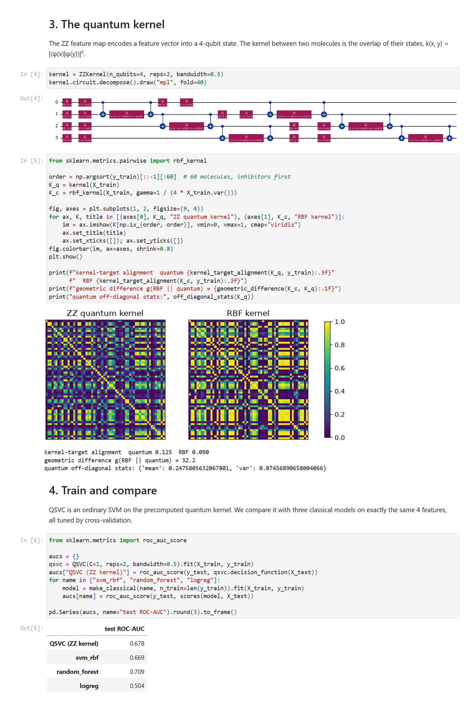

---

## 🛠️ Tech Stack

| Layer | Technology |
| :--- | :--- |
| Language | Python 3.11+ |
| Quantum SDK | Qiskit 2.x, Qiskit Aer, Qiskit IBM Runtime (fake backends and a real device) |
| Quantum ML | ZZ feature map fidelity kernel + scikit-learn SVM (QSVC) |
| Chemistry | RDKit (SMILES parsing, Morgan fingerprints, Murcko scaffolds) |
| Classical ML | scikit-learn (SVM-RBF, Random Forest, Logistic Regression, PCA) |
| Simulation | Statevector (exact kernel), AerSimulator with FakeTorino noise model |
| Hardware | IBM Quantum Platform, ibm_marrakesh (156 qubits), open plan |
| Testing / CI | pytest, ruff, GitHub Actions |
| Environment | JupyterLab / VS Code, `venv`, Docker |
| Version control | Git + GitHub |

---

## 📁 Project Structure

```text
vtu-hc-blackout/
├── README.md              # This file
├── requirements.txt       # Python dependencies
├── pyproject.toml         # Package metadata and the `qudock` command
├── Dockerfile
├── docs/demo.png          # Demo screenshot
├── .github/workflows/     # CI (ruff + pytest), docs deploy, PyPI release on tags
├── notebooks/
│   └── demo.ipynb         # End-to-end walkthrough of the pipeline and results
├── src/qudock/
│   ├── data.py            # BACE and BBBP download, cleaning, scaffold split
│   ├── features.py        # ECFP fingerprints (+ descriptors) -> PCA or PLS -> qubit angles
│   ├── classical.py       # SVM-RBF, Random Forest, Logistic Regression
│   ├── quantum.py         # ZZ fidelity kernel and QSVC
│   ├── benchmark.py       # Sample-efficiency benchmark and statistics
│   ├── analysis.py        # Geometric difference, alignment, concentration
│   ├── sweep.py           # Qubit sweep
│   ├── noise.py           # Shot-based kernel estimation, PSD repair
│   ├── noise_study.py     # Noise study on a fake IBM backend
│   ├── hardware.py        # Kernel on a real IBM device
│   ├── kernels.py         # Tanimoto, projected and hybrid kernels, bandwidth tuning
│   ├── screening.py       # Enrichment, BEDROC, PR-AUC, paired bootstrap
│   ├── conformal.py       # Calibrated confidence and the applicability domain
│   ├── explain.py         # Which atoms drove a prediction, by fingerprint-bit occlusion
│   ├── robustness.py      # The same comparison on several reseeded scaffold splits
│   ├── campaign.py        # Screening campaign loop: test, retrain, pick the next batch
│   ├── cost.py            # Seconds, circuits and device time each model needs
│   ├── scaling.py         # Kernel concentration and accuracy from 4 to 14 qubits
│   ├── trainable.py       # Feature map whose own parameters are trained by alignment
│   ├── scorecard.py       # Quantum against classical across every setting
│   ├── final_study.py     # Final-round study
│   ├── hardware_svm.py    # Projected-kernel SVM trained and tested on a real device
│   ├── graphmap.py        # Feature map built from the pharmacophore graph
│   ├── shadows.py         # Classical-shadow estimates of one- and two-qubit Paulis
│   ├── screen.py          # Rank libraries: activity x brain penetration x drug-likeness
│   ├── bench.py           # QuDock-Bench: fixed tasks, splits and seeds for any model
│   ├── api.py             # HTTP API around the screener (`qudock serve`)
│   ├── provenance.py      # provenance.json next to every result
│   ├── plots.py           # Figures
│   └── cli.py             # `qudock` command line
├── app/app.py             # Streamlit web app: screen molecules, compare models
├── results/full/          # Benchmark, sweep and noise study outputs
├── results/hardware/      # Real-device kernel run
├── results/final/         # Final-round study outputs
├── results/scaling/       # Kernel concentration study
├── results/confidence/    # Conformal prediction and applicability domain
├── results/explain/       # Atom-level explanations and the check that they hold
├── results/robustness/    # The comparison repeated on six scaffold splits
├── results/campaign/      # Screening campaign simulation
├── results/cost/          # Runtime, circuit counts and device time
├── results/bbbp/          # The same pipeline on a second dataset
├── results/trainable/     # Trained feature map study
├── results/scorecard/     # The scorecard table and chart
├── data/                  # Downloaded dataset cache (not committed)
├── docs/                  # Documentation site (mkdocs), deployed to GitHub Pages
├── Makefile               # make install / lint / test / check / app
├── CITATION.cff           # How to cite QuDock
└── tests/                 # Unit tests
```

---

## 🚀 How to Run

### Prerequisites

- Python 3.11 or newer
- [Git](https://git-scm.com/downloads)
- A GitHub account (you need collaborator access to this repo)

### 1. Clone the repository

```bash
git clone https://github.com/vtu-qiskit-fall-fest-2026/vtu-hc-blackout.git
cd vtu-hc-blackout
```

### 2. Create a virtual environment

```bash
python3 -m venv .venv
source .venv/bin/activate        # Linux / macOS
# .venv\Scripts\activate         # Windows (PowerShell)
```

### 3. Install dependencies

```bash
pip install --upgrade pip
pip install -e .[dev]            # or: pip install -r requirements.txt
```

> **Linux only:** if importing Qiskit Aer fails with *"cannot allocate memory in static TLS
> block"*, run `export GLIBC_TUNABLES=glibc.rtld.optional_static_tls=4096000` first, together
> with `export RUST_MIN_STACK=33554432` so the transpiler's threads keep enough stack.

### 4. Run

```bash
qudock data                          # download BACE, show split sizes
qudock benchmark --out results/full  # learning curves, ~15 min
qudock sweep --out results/full      # 2-10 qubit sweep + kernel diagnostics, ~15 min
qudock noise --out results/full      # shot + device noise study, ~30 min
qudock hardware --reanalyse          # redo the real-device comparison from saved results
qudock hardware                      # rerun on a real IBM device (needs a saved IBM account)
qudock final --out results/final     # final-round study: PLS, tuned bandwidth, hybrid, under an hour
qudock final --dataset bbbp          # the same pipeline on blood-brain barrier data
qudock scaling --out results/scaling # kernel concentration from 4 to 14 qubits, ~10 min
qudock trainable                     # train the feature map by kernel alignment, ~10 min
qudock confidence                    # conformal prediction sets and accuracy by similarity
qudock explain                       # which atoms drove each prediction, and a check that they did
qudock robustness                    # repeat the whole comparison on six scaffold splits
qudock campaign                      # simulate a screening campaign: test, retrain, pick again
qudock cost                          # seconds, circuits and device time per model
qudock scorecard                     # one chart of every setting, from the result files
qudock reproduce                     # rerun every study that makes a table or figure
qudock hardware-svm --fake           # projected-kernel SVM on a simulated IBM device
qudock hardware-svm                  # same on a real IBM device, capped at 5 min of quantum time
qudock hardware-svm --mitigation zne # with zero-noise extrapolation on top of readout mitigation
qudock graph                         # pharmacophore-graph feature map vs classical twins
qudock bench                         # QuDock-Bench leaderboard on BACE, BBBP and ClinTox
qudock bench --models my_models:my_svm,rf_fingerprint   # score your own model
qudock screen library.csv            # rank a library: activity x BBB x drug-likeness
qudock screen                        # rank the BACE test set and check it against labels
qudock serve                         # HTTP API (pip install -e .[api]), docs at /docs
```

Every command that writes results also writes `provenance.json` (command, git commit,
package versions, dataset hashes) into the same folder.

Or try the web app, live at [qudock-blackout.streamlit.app](https://qudock-blackout.streamlit.app/) or locally, where you can screen your own molecules and change the settings:

```bash
pip install -e ".[app]"
streamlit run app/app.py         # opens http://localhost:8501
```

Or open the walkthrough notebook:

```bash
jupyter lab notebooks/demo.ipynb
```

Or with Docker:

```bash
docker build -t qudock .
docker run --rm -v "$PWD/results:/app/results" qudock benchmark --out results/full
```

### 5. Run the tests

```bash
make check                       # ruff + pytest with the right environment variables
# or: pytest -q
```

Full documentation: `pip install -e .[docs] && mkdocs serve`, then open http://127.0.0.1:8000.

---

## 🔁 How to Push Code

> Full walkthrough: **[Git & Collaboration Handbook](../vtu-hc-guide-git-and-collaboration)**, covering
> the collaboration workflow, branches, pull requests, reviews and conflict resolution.

### Configure Git (first time only)

```bash
git config --global user.name  "Your Name"
git config --global user.email "you@example.com"
```

### Everyday workflow

```bash
# 1. Get the latest changes
git checkout main
git pull origin main

# 2. Create a branch for your work
git checkout -b feature/my-task

# 3. Commit your work
git add .
git commit -m "feat: add variational circuit for the search problem"

# 4. Push the branch
git push -u origin feature/my-task

# 5. Open a Pull Request on GitHub and request a review
#    https://github.com/vtu-qiskit-fall-fest-2026/vtu-hc-blackout/compare/main...feature/my-task

# 6. After approval, merge into main
git checkout main
git pull origin main
git branch -d feature/my-task
```

### Commit message convention

| Prefix | Meaning |
| :--- | :--- |
| `feat:` | New feature |
| `fix:` | Bug fix |
| `docs:` | Documentation only |
| `test:` | Adding or fixing tests |
| `refactor:` | Code restructure, no behaviour change |
| `chore:` | Build/config/dependency changes |

### Useful commands

```bash
git status              # what changed
git log --oneline -10   # recent commits
git diff                # review changes before committing
git stash               # shelve changes temporarily
git pull --rebase       # update your branch on top of main
```

### Collaborating on the same repo

- **Never push directly to `main`.** Open a Pull Request instead.
- **Pull before you push** to avoid rejected commits.
- **Commit often** with clear messages.
- **Resolve conflicts** locally: `git pull --rebase`, fix the files, then `git add` + `git rebase --continue`.
- **Ask for a review** before merging. A second pair of eyes catches bugs fast.

---

## ✅ Submission Checklist

- [x] Repository created and **public**
- [x] All team members added as **collaborators** and invitations accepted
- [x] `README.md` updated with project details, problem statement and solution
- [x] Team members listed under [Team Members](#-team-members-github-ids)
- [x] `requirements.txt` committed and project runs from a clean clone
- [x] Code pushed to `main` and the latest `main` builds successfully
- [x] Notebooks committed with **cleared outputs** (or use `nbstrip`)
- [x] `README` includes a demo screenshot / video link

---

## 📚 Resources

| Resource | Link |
| :--- | :--- |
| 🔁 Git & collaboration handbook | [Git & Collaboration Handbook](../vtu-hc-guide-git-and-collaboration) |
| ❓ Problem statements, solutions & terms | [Problem Statements, Solutions & Terms](../vtu-hc-guide-problem-and-solution) |
| 📄 README writing guide | [README Guide & Template](../vtu-hc-guide-readme-template) |
| ⚛️ Qiskit documentation | https://docs.quantum.ibm.com/ |
| ⚛️ Qiskit Runtime & primitives | https://quantum.cloud.ibm.com/docs/ |
| 🧪 Qiskit Aer simulator | https://docs.quantum.ibm.com/guides/simulator |
| 💻 IBM Quantum Platform | https://quantum.cloud.ibm.com/ |
| 🎓 Qiskit textbook | https://qiskit.qotlabs.org/learning/ |
| 📋 GitHub Docs | https://docs.github.com/ |

---

## 📄 License

Released under the [MIT License](LICENSE). See `LICENSE` for details.

---

<div align="center">

**BlackOut** · Team ID `VTU-QFF-HC-0140` · Tier `Online`
· Built with ⚛️ Qiskit for the VTU-QFF Hackathon

[⬆ Back to Top](#blackout)

</div>
