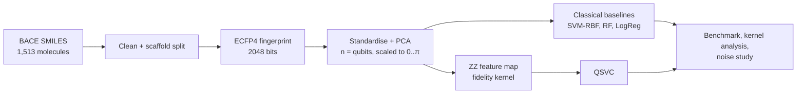

<div align="center">

# BlackOut

**VTU-QFF-HC-0140** &nbsp;|&nbsp; Tier: **Online**

</div>

---

<div align="center">

| | |
| :--- | :--- |
| **Team** | BlackOut |
| **Team ID** | VTU-QFF-HC-0140 |
| **Tier** | Online |
| **Repository** | [vtu-hc-blackout](https://github.com/vtu-qiskit-fall-fest-2026/vtu-hc-blackout.git) |
| **Organisation** | [vtu-qiskit-fall-fest-2026](https://github.com/vtu-qiskit-fall-fest-2026) |
| **Event** | VTU-QFF Hackathon — VTU-Qiskit Fall Fest 2026 |

</div>

---

## 📌 Table of Contents

- [Team Members](#-team-members-github-ids)
- [Problem Statement](#-problem-statement)
- [Proposed Solution](#-proposed-solution)
- [Approach & Architecture](#-approach--architecture)
- [Results](#-results)
- [Tech Stack](#-tech-stack)
- [Project Structure](#-project-structure)
- [How to Run](#-how-to-run)
- [How to Push Code](#-how-to-push-code)
- [Submission Checklist](#-submission-checklist)
- [Resources](#-resources)
- [License](#-license)

---

## 👥 Team Members (GitHub IDs)

> Members are added to this repository as **collaborators** and must accept the
> GitHub invitation before they can push. Add your GitHub username below.

| # | Name | GitHub Username | Role |
| :-- | :--- | :--- | :--- |
| 1 | Shubhodeep Chatterjee | [@shubhodeepcx](https://github.com/shubhodeepcx) | Team Lead |
| 2 | Srijita Banerjee | [@srijita29-stack](https://github.com/srijita29-stack) | Developer |
| 3 | Rounak Pal | [@Rounak639](https://github.com/Rounak639) | Developer |

<!--
Optional: add a plain list instead of the table above.
- @username1
- @username2
-->

---

## ❓ Problem Statement

<!--
State the problem you are solving. Be specific: what is broken or missing,
who experiences it, and why does it matter. Link to the official problem
statement from the brief if one applies.
-->

**Problem:** Early-stage drug discovery screens thousands of molecules to find the few that
inhibit a target protein, and labelled activity data is expensive, so models often have to
learn from very few examples. Quantum kernel methods are often proposed as a way to learn more
from less data, but claims of quantum advantage are rarely tested fairly against tuned classical
baselines, on realistic splits, or under hardware noise.

**Why it matters:** β-secretase 1 (BACE-1) is a leading Alzheimer's disease target. Knowing
*where* (if anywhere) a quantum kernel helps, and how much of its behaviour survives real
devices, tells us whether quantum machine learning is worth using for virtual screening today.

**Track / Category:** Online · Quantum machine learning · Drug discovery

---

## 💡 Proposed Solution

<!--
Describe your solution. Keep it concrete: the core idea, the user flow, and
the quantum/ML technique you are applying.
-->

**Solution:** **QuDock**, a reproducible hybrid quantum–classical pipeline that predicts
BACE-1 inhibition from molecular structure. It encodes compressed molecular fingerprints into a
ZZ feature map, trains a quantum-kernel SVM (QSVC), and benchmarks it head-to-head against
SVM-RBF, Random Forest and Logistic Regression on identical features, from 25 to 1,210 training
molecules, across 2 to 10 qubits, and under simulated IBM hardware noise.

**Key idea:** A fidelity quantum kernel $k(x, y) = |\langle\phi(x)|\phi(y)\rangle|^2$ on a
ZZ feature map, judged by a fair, statistically tested benchmark plus kernel-geometry diagnostics
(geometric difference, kernel-target alignment, concentration).

**Why this works:** Every model sees exactly the same qubit-sized features, splits are by
molecular scaffold (the test set holds unseen chemotypes), hyperparameters are tuned by
cross-validation, and results are averaged over seeds with paired significance tests, so any gap
between quantum and classical is real rather than an artefact of the setup.

---

## 🧩 Approach & Architecture

<!--
Walk through how it works. A simple pipeline diagram in text or Mermaid is ideal.
-->



1. **Input** — MoleculeNet BACE: 1,513 SMILES strings, each labelled inhibitor / non-inhibitor
   (`qudock.data`).
2. **Preprocessing** — canonicalise SMILES, drop unparsable and conflicting duplicates,
   Bemis–Murcko scaffold split (1,210 train / 303 test); Morgan (ECFP4) fingerprints → standardise
   → PCA to one component per qubit → rescale to [0, π], all fit on training data only
   (`qudock.features`).
3. **Quantum core** — ZZFeatureMap (linear entanglement, 1–2 reps, tunable bandwidth). The kernel
   is computed exactly from statevectors (cached) for the benchmark, and from compute–uncompute
   circuits with finite shots on AerSimulator, with and without the FakeTorino noise model, for
   the noise study (`qudock.quantum`, `qudock.noise`).
4. **Post-processing** — SVM on the precomputed kernel; hyperparameters (C, bandwidth) chosen by
   stratified inner cross-validation; noisy kernels optionally repaired to the nearest PSD matrix.
5. **Output** — test ROC-AUC, accuracy, F1, MCC per model, training size and seed; Wilcoxon tests
   of QSVC vs the best classical model; kernel diagnostics; figures in `results/full/`.

---

## 📊 Results

All numbers are test ROC-AUC on the scaffold split. Full tables and figures are in
[`results/full/`](results/full); the [demo notebook](notebooks/demo.ipynb) walks through them.

**Sample efficiency** (6 qubits, mean of 5 seeds):

| Training molecules | QSVC | SVM-RBF | Random Forest | Logistic Regression |
| --: | --: | --: | --: | --: |
| 25 | 0.592 | 0.644 | 0.625 | 0.623 |
| 50 | 0.588 | 0.653 | 0.640 | 0.594 |
| 100 | 0.649 | 0.666 | 0.700 | 0.573 |
| 200 | 0.673 | 0.692 | 0.704 | 0.593 |
| 400 | 0.688 | 0.703 | 0.723 | 0.596 |
| 1,210 | 0.687 | 0.683 | 0.740 | 0.607 |


**Qubit sweep** (full training set, mean of 3 seeds): QSVC peaks at 0.719 with 8 qubits, ahead
of SVM-RBF (0.705) and Logistic Regression (0.626) but behind Random Forest (0.729).


**Noise study** (4 qubits, 80 train / 40 test molecules, 3 seeds, simulated IBM Torino):
kernel entries are estimated from measurement shots, with and without the FakeTorino device
noise model. Values are relative kernel error / test ROC-AUC (raw kernel, no PSD repair).

| Setting | reps = 1 | reps = 2 |
| :-- | --: | --: |
| Exact kernel | 0.000 / 0.650 | 0.000 / 0.626 |
| Shots only, 256 | 0.055 / 0.616 | 0.064 / 0.628 |
| Shots only, 1024 | 0.027 / 0.649 | 0.032 / 0.622 |
| Shots only, 4096 | 0.014 / 0.639 | 0.016 / 0.623 |
| FakeTorino, 256 | 0.257 / 0.660 | 0.283 / 0.655 |
| FakeTorino, 1024 | 0.251 / 0.664 | 0.277 / 0.637 |
| FakeTorino, 4096 | 0.250 / 0.645 | 0.276 / 0.631 |


**What we learned**

- QSVC is competitive with an RBF SVM on the same features and clearly beats Logistic
  Regression from 100 molecules up, but it never beats Random Forest. The gap to the best
  classical model is 0.03–0.07 ROC-AUC at every training size. With 5 seeds none of these gaps
  reaches significance (smallest possible Wilcoxon p = 0.06).
- No small-data advantage: at 25–50 molecules QSVC is the *weakest* model, not the strongest.
- The quantum kernel is geometrically very different from RBF (geometric difference up to ~100) and,
  at bandwidth 0.5, aligns better with the labels (0.15–0.18 vs 0.09–0.10), but that extra
  structure doesn't translate into better predictions here.
- Kernel concentration is real: at bandwidth 1.0 the variance of off-diagonal kernel values
  drops from 0.075 at 2 qubits to 0.005 at 10, so bandwidth tuning is essential.
- Device noise distorts the kernel far more than shot noise: a 25–28% error that more shots
  cannot remove, against 1.4–6.4% from shots alone. Yet test ROC-AUC stays at 0.62–0.66 in every
  setting, and the spread between seeds (±0.05–0.10) means we can't measure any difference at
  this sample size. Repairing the noisy kernel to be positive semi-definite barely matters.

---

## 🛠️ Tech Stack

| Layer | Technology |
| :--- | :--- |
| Language | Python 3.11+ |
| Quantum SDK | Qiskit 2.x, Qiskit Aer, Qiskit IBM Runtime (fake backends) |
| Quantum ML | ZZ feature map fidelity kernel + scikit-learn SVM (QSVC) |
| Chemistry | RDKit (SMILES parsing, Morgan fingerprints, Murcko scaffolds) |
| Classical ML | scikit-learn (SVM-RBF, Random Forest, Logistic Regression, PCA) |
| Simulation | Statevector (exact kernel), AerSimulator with FakeTorino noise model |
| Testing / CI | pytest, ruff, GitHub Actions |
| Environment | JupyterLab / VS Code, `venv`, Docker |
| Version control | Git + GitHub |

---

## 📁 Project Structure

```text
vtu-hc-blackout/
├── README.md              # This file
├── requirements.txt       # Python dependencies
├── pyproject.toml         # Package metadata and the `qudock` command
├── Dockerfile
├── .github/workflows/     # CI: ruff + pytest on every push
├── notebooks/
│   └── demo.ipynb         # End-to-end walkthrough of the pipeline and results
├── src/qudock/
│   ├── data.py            # BACE download, cleaning, scaffold split
│   ├── features.py        # ECFP fingerprints -> PCA -> qubit angles
│   ├── classical.py       # SVM-RBF, Random Forest, Logistic Regression
│   ├── quantum.py         # ZZ fidelity kernel and QSVC
│   ├── benchmark.py       # Sample-efficiency benchmark and statistics
│   ├── analysis.py        # Geometric difference, alignment, concentration
│   ├── sweep.py           # Qubit sweep
│   ├── noise.py           # Shot-based kernel estimation, PSD repair
│   ├── noise_study.py     # Noise study on a fake IBM backend
│   ├── plots.py           # Figures
│   └── cli.py             # `qudock` command line
├── results/full/          # Benchmark, sweep and noise study outputs
├── data/                  # Downloaded dataset cache (not committed)
└── tests/                 # Unit tests
```

---

## 🚀 How to Run

### Prerequisites

- Python 3.11 or newer
- [Git](https://git-scm.com/downloads)
- A GitHub account (you need collaborator access to this repo)

### 1. Clone the repository

```bash
git clone https://github.com/vtu-qiskit-fall-fest-2026/vtu-hc-blackout.git
cd vtu-hc-blackout
```

### 2. Create a virtual environment

```bash
python3 -m venv .venv
source .venv/bin/activate        # Linux / macOS
# .venv\Scripts\activate         # Windows (PowerShell)
```

### 3. Install dependencies

```bash
pip install --upgrade pip
pip install -e .[dev]            # or: pip install -r requirements.txt
```

> **Linux only:** if importing Qiskit Aer fails with *"cannot allocate memory in static TLS
> block"*, run `export GLIBC_TUNABLES=glibc.rtld.optional_static_tls=4096000` first.

### 4. Run

```bash
qudock data                          # download BACE, show split sizes
qudock benchmark --out results/full  # learning curves, ~15 min
qudock sweep --out results/full      # 2-10 qubit sweep + kernel diagnostics, ~15 min
qudock noise --out results/full      # shot + device noise study, ~30 min
```

Or open the walkthrough notebook:

```bash
jupyter lab notebooks/demo.ipynb
```

Or with Docker:

```bash
docker build -t qudock .
docker run --rm -v "$PWD/results:/app/results" qudock benchmark --out results/full
```

### 5. Run the tests

```bash
pytest -q
```

---

## 🔁 How to Push Code

> Full walkthrough: **[Git & Collaboration Handbook](../vtu-hc-guide-git-and-collaboration)** — collaboration
> workflow, branches, pull requests, reviews and conflict resolution.

### Configure Git (first time only)

```bash
git config --global user.name  "Your Name"
git config --global user.email "you@example.com"
```

### Everyday workflow

```bash
# 1. Get the latest changes
git checkout main
git pull origin main

# 2. Create a branch for your work
git checkout -b feature/my-task

# 3. Commit your work
git add .
git commit -m "feat: add variational circuit for the search problem"

# 4. Push the branch
git push -u origin feature/my-task

# 5. Open a Pull Request on GitHub and request a review
#    https://github.com/vtu-qiskit-fall-fest-2026/vtu-hc-blackout/compare/main...feature/my-task

# 6. After approval, merge into main
git checkout main
git pull origin main
git branch -d feature/my-task
```

### Commit message convention

| Prefix | Meaning |
| :--- | :--- |
| `feat:` | New feature |
| `fix:` | Bug fix |
| `docs:` | Documentation only |
| `test:` | Adding or fixing tests |
| `refactor:` | Code restructure, no behaviour change |
| `chore:` | Build/config/dependency changes |

### Useful commands

```bash
git status              # what changed
git log --oneline -10   # recent commits
git diff                # review changes before committing
git stash               # shelve changes temporarily
git pull --rebase       # update your branch on top of main
```

### Collaborating on the same repo

- **Never push directly to `main`** — open a Pull Request.
- **Pull before you push** to avoid rejected commits.
- **Commit often** with clear messages.
- **Resolve conflicts** locally: `git pull --rebase`, fix the files, then `git add` + `git rebase --continue`.
- **Ask for a review** before merging — a second pair of eyes catches bugs fast.

---

## ✅ Submission Checklist

- [ ] Repository created and **public**
- [ ] All team members added as **collaborators** and invitations accepted
- [ ] `README.md` updated with project details, problem statement and solution
- [ ] Team members listed under [Team Members](#-team-members-github-ids)
- [ ] `requirements.txt` committed and project runs from a clean clone
- [ ] Code pushed to `main` and the latest `main` builds successfully
- [ ] Notebooks committed with **cleared outputs** (or use `nbstrip`)
- [ ] `README` includes a demo screenshot / video link
- [ ] Short project summary submitted on the hackathon portal

---

## 📚 Resources

| Resource | Link |
| :--- | :--- |
| 🔁 Git & collaboration handbook | [Git & Collaboration Handbook](../vtu-hc-guide-git-and-collaboration) |
| ❓ Problem statements, solutions & terms | [Problem Statements, Solutions & Terms](../vtu-hc-guide-problem-and-solution) |
| 📄 README writing guide | [README Guide & Template](../vtu-hc-guide-readme-template) |
| ⚛️ Qiskit documentation | https://docs.quantum.ibm.com/ |
| ⚛️ Qiskit Runtime & primitives | https://quantum.cloud.ibm.com/docs/ |
| 🧪 Qiskit Aer simulator | https://docs.quantum.ibm.com/guides/simulator |
| 💻 IBM Quantum Platform | https://quantum.cloud.ibm.com/ |
| 🎓 Qiskit textbook | https://qiskit.qotlabs.org/learning/ |
| 📋 GitHub Docs | https://docs.github.com/ |

---

## 📄 License

Released under the [MIT License](LICENSE). See `LICENSE` for details.

---

<div align="center">

**BlackOut** · Team ID `VTU-QFF-HC-0140` · Tier `Online`
· Built with ⚛️ Qiskit for the VTU-QFF Hackathon

[⬆ Back to Top](#blackout)

</div>
