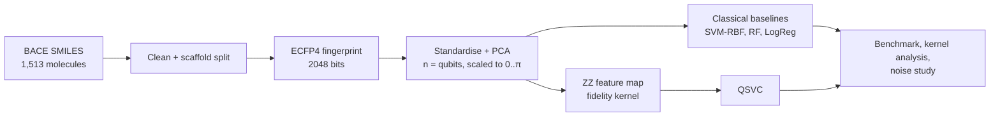

<div align="center">

# BlackOut

**VTU-QFF-HC-0140** &nbsp;|&nbsp; Tier: **Online**

</div>

---

<div align="center">

| | |
| :--- | :--- |
| **Team** | BlackOut |
| **Team ID** | VTU-QFF-HC-0140 |
| **Tier** | Online |
| **Repository** | [vtu-hc-blackout](https://github.com/vtu-qiskit-fall-fest-2026/vtu-hc-blackout.git) |
| **Organisation** | [vtu-qiskit-fall-fest-2026](https://github.com/vtu-qiskit-fall-fest-2026) |
| **Event** | VTU-QFF Hackathon, VTU-Qiskit Fall Fest 2026 |

</div>

---

## 📌 Table of Contents

- [Team Members](#-team-members-github-ids)
- [Problem Statement](#-problem-statement)
- [Proposed Solution](#-proposed-solution)
- [Approach & Architecture](#-approach--architecture)
- [Results](#-results)
- [Tech Stack](#-tech-stack)
- [Project Structure](#-project-structure)
- [How to Run](#-how-to-run)
- [How to Push Code](#-how-to-push-code)
- [Submission Checklist](#-submission-checklist)
- [Resources](#-resources)
- [License](#-license)

---

## 👥 Team Members (GitHub IDs)

> Members are added to this repository as **collaborators** and must accept the
> GitHub invitation before they can push. Add your GitHub username below.

| # | Name | GitHub Username | Role |
| :-- | :--- | :--- | :--- |
| 1 | Shubhodeep Chatterjee | [@shubhodeepcx](https://github.com/shubhodeepcx) | Team Lead |
| 2 | Srijita Banerjee | [@srijita29-stack](https://github.com/srijita29-stack) | Developer |
| 3 | Rounak Pal | [@Rounak639](https://github.com/Rounak639) | Developer |

<!--
Optional: add a plain list instead of the table above.
- @username1
- @username2
-->

---

## ❓ Problem Statement

<!--
State the problem you are solving. Be specific: what is broken or missing,
who experiences it, and why does it matter. Link to the official problem
statement from the brief if one applies.
-->

**Problem:** In early drug discovery, thousands of molecules are screened to find the few that
block a target protein. Lab-measured activity data is expensive, so models often have to learn
from only a handful of examples. Quantum kernels are often said to learn more from less data,
but these claims are rarely checked against properly tuned classical models, on realistic data
splits, or with hardware noise included.

**Why it matters:** β-secretase 1 (BACE-1) is an important drug target for Alzheimer's disease.
If we know where a quantum kernel actually helps (if it helps at all) and how well it holds up
on noisy hardware, we can judge whether quantum machine learning is useful for virtual
screening right now.

**Track / Category:** Online · Quantum machine learning · Drug discovery

---

## 💡 Proposed Solution

<!--
Describe your solution. Keep it concrete: the core idea, the user flow, and
the quantum/ML technique you are applying.
-->

**Solution:** We built **QuDock**, a hybrid quantum and classical pipeline that predicts whether
a molecule inhibits BACE-1. Molecular fingerprints are compressed and loaded into a ZZ feature
map, and a quantum kernel SVM (QSVC) is trained on the result. We compare it with SVM-RBF,
Random Forest and Logistic Regression on the same features, with 25 to 1,210 training
molecules, 2 to 10 qubits, and simulated IBM hardware noise.

**Key idea:** Use the fidelity kernel $k(x, y) = |\langle\phi(x)|\phi(y)\rangle|^2$ of a ZZ
feature map, and test it with a fair benchmark plus a few checks on the kernel itself
(geometric difference, kernel-target alignment and concentration).

**Why this works:** All models get exactly the same features. The data is split by molecular
scaffold, so the test set contains molecule families the models have never seen.
Hyperparameters are tuned with cross-validation, and every result is averaged over several
seeds and checked with a paired significance test. So if quantum and classical results differ,
it is because of the models and not because of how we set up the comparison.

---

## 🧩 Approach & Architecture

<!--
Walk through how it works. A simple pipeline diagram in text or Mermaid is ideal.
-->



1. **Input:** the MoleculeNet BACE dataset, 1,513 SMILES strings, each labelled as inhibitor or
   non-inhibitor (`qudock.data`).
2. **Preprocessing:** we canonicalise the SMILES, drop molecules that can't be parsed or have
   conflicting labels, and split by Bemis-Murcko scaffold (1,210 train, 303 test). Each molecule
   becomes a Morgan (ECFP4) fingerprint, which is standardised, reduced with PCA to one value per
   qubit and rescaled to [0, π]. All of this is fit on the training data only
   (`qudock.features`).
3. **Quantum core:** a ZZFeatureMap with linear entanglement, 1 or 2 reps and a tunable
   bandwidth. For the benchmark the kernel is computed exactly from statevectors (and cached).
   For the noise study it is estimated from compute-uncompute circuits with a finite number of
   shots on AerSimulator, with and without the FakeTorino noise model (`qudock.quantum`,
   `qudock.noise`).
4. **Post-processing:** an SVM is trained on the precomputed kernel, with C and bandwidth chosen
   by stratified inner cross-validation. Noisy kernels can optionally be repaired to the nearest
   positive semi-definite (PSD) matrix.
5. **Output:** test ROC-AUC, accuracy, F1 and MCC for each model, training size and seed,
   Wilcoxon tests of QSVC against the best classical model, kernel diagnostics, and figures in
   `results/full/`.

---

## 📊 Results

All numbers are test ROC-AUC on the scaffold split. The full tables and figures are in
[`results/full/`](results/full), and the [demo notebook](notebooks/demo.ipynb) goes through them
step by step.

**Sample efficiency** (6 qubits, average of 5 seeds):

| Training molecules | QSVC | SVM-RBF | Random Forest | Logistic Regression |
| --: | --: | --: | --: | --: |
| 25 | 0.592 | 0.644 | 0.625 | 0.623 |
| 50 | 0.588 | 0.653 | 0.640 | 0.594 |
| 100 | 0.649 | 0.666 | 0.700 | 0.573 |
| 200 | 0.673 | 0.692 | 0.704 | 0.593 |
| 400 | 0.688 | 0.703 | 0.723 | 0.596 |
| 1,210 | 0.687 | 0.683 | 0.740 | 0.607 |


**Qubit sweep** (full training set, average of 3 seeds): QSVC does best with 8 qubits, at 0.719.
That is better than SVM-RBF (0.705) and Logistic Regression (0.626) but still below Random
Forest (0.729).


**Noise study** (4 qubits, 80 train and 40 test molecules, 3 seeds, simulated IBM Torino):
here each kernel entry is estimated from measurement shots, with and without the noise model of
the FakeTorino device. Each cell shows relative kernel error / test ROC-AUC, using the raw kernel
without PSD repair.

| Setting | reps = 1 | reps = 2 |
| :-- | --: | --: |
| Exact kernel | 0.000 / 0.650 | 0.000 / 0.626 |
| Shots only, 256 | 0.055 / 0.616 | 0.064 / 0.628 |
| Shots only, 1024 | 0.027 / 0.649 | 0.032 / 0.622 |
| Shots only, 4096 | 0.014 / 0.639 | 0.016 / 0.623 |
| FakeTorino, 256 | 0.257 / 0.660 | 0.283 / 0.655 |
| FakeTorino, 1024 | 0.251 / 0.664 | 0.277 / 0.637 |
| FakeTorino, 4096 | 0.250 / 0.645 | 0.276 / 0.631 |


**What we learned**

- QSVC does about as well as an RBF SVM on the same features and beats Logistic Regression
  from 100 molecules up, but it never beats Random Forest. It is 0.03 to 0.07 ROC-AUC behind
  the best classical model at every training size. With only 5 seeds none of these gaps is
  statistically significant (the smallest possible Wilcoxon p-value is 0.06).
- We found no advantage with little data. With 25 or 50 training molecules QSVC is actually the
  weakest model.
- The quantum kernel is very different from the RBF kernel (geometric difference up to about
  100), and at bandwidth 0.5 it lines up better with the labels (alignment 0.15 to 0.18, against
  0.09 to 0.10 for RBF). That didn't lead to better predictions on this dataset.
- Kernel concentration shows up clearly. At bandwidth 1.0 the variance of the off-diagonal
  kernel values falls from 0.075 at 2 qubits to 0.005 at 10 qubits, so the bandwidth has to be
  tuned.
- Device noise changes the kernel much more than shot noise does. It causes 25 to 28% error
  that more shots don't fix, while shot noise alone causes 1.4 to 6.4%. Even so, test ROC-AUC
  stays between 0.62 and 0.66 in every setting, and with the variation between seeds (about
  0.05 to 0.10) we can't measure a difference at this sample size. Repairing the noisy kernel to
  be PSD makes almost no difference.

---

## 🛠️ Tech Stack

| Layer | Technology |
| :--- | :--- |
| Language | Python 3.11+ |
| Quantum SDK | Qiskit 2.x, Qiskit Aer, Qiskit IBM Runtime (fake backends) |
| Quantum ML | ZZ feature map fidelity kernel + scikit-learn SVM (QSVC) |
| Chemistry | RDKit (SMILES parsing, Morgan fingerprints, Murcko scaffolds) |
| Classical ML | scikit-learn (SVM-RBF, Random Forest, Logistic Regression, PCA) |
| Simulation | Statevector (exact kernel), AerSimulator with FakeTorino noise model |
| Testing / CI | pytest, ruff, GitHub Actions |
| Environment | JupyterLab / VS Code, `venv`, Docker |
| Version control | Git + GitHub |

---

## 📁 Project Structure

```text
vtu-hc-blackout/
├── README.md              # This file
├── requirements.txt       # Python dependencies
├── pyproject.toml         # Package metadata and the `qudock` command
├── Dockerfile
├── .github/workflows/     # CI: ruff + pytest on every push
├── notebooks/
│   └── demo.ipynb         # End-to-end walkthrough of the pipeline and results
├── src/qudock/
│   ├── data.py            # BACE download, cleaning, scaffold split
│   ├── features.py        # ECFP fingerprints -> PCA -> qubit angles
│   ├── classical.py       # SVM-RBF, Random Forest, Logistic Regression
│   ├── quantum.py         # ZZ fidelity kernel and QSVC
│   ├── benchmark.py       # Sample-efficiency benchmark and statistics
│   ├── analysis.py        # Geometric difference, alignment, concentration
│   ├── sweep.py           # Qubit sweep
│   ├── noise.py           # Shot-based kernel estimation, PSD repair
│   ├── noise_study.py     # Noise study on a fake IBM backend
│   ├── plots.py           # Figures
│   └── cli.py             # `qudock` command line
├── results/full/          # Benchmark, sweep and noise study outputs
├── data/                  # Downloaded dataset cache (not committed)
└── tests/                 # Unit tests
```

---

## 🚀 How to Run

### Prerequisites

- Python 3.11 or newer
- [Git](https://git-scm.com/downloads)
- A GitHub account (you need collaborator access to this repo)

### 1. Clone the repository

```bash
git clone https://github.com/vtu-qiskit-fall-fest-2026/vtu-hc-blackout.git
cd vtu-hc-blackout
```

### 2. Create a virtual environment

```bash
python3 -m venv .venv
source .venv/bin/activate        # Linux / macOS
# .venv\Scripts\activate         # Windows (PowerShell)
```

### 3. Install dependencies

```bash
pip install --upgrade pip
pip install -e .[dev]            # or: pip install -r requirements.txt
```

> **Linux only:** if importing Qiskit Aer fails with *"cannot allocate memory in static TLS
> block"*, run `export GLIBC_TUNABLES=glibc.rtld.optional_static_tls=4096000` first.

### 4. Run

```bash
qudock data                          # download BACE, show split sizes
qudock benchmark --out results/full  # learning curves, ~15 min
qudock sweep --out results/full      # 2-10 qubit sweep + kernel diagnostics, ~15 min
qudock noise --out results/full      # shot + device noise study, ~30 min
```

Or open the walkthrough notebook:

```bash
jupyter lab notebooks/demo.ipynb
```

Or with Docker:

```bash
docker build -t qudock .
docker run --rm -v "$PWD/results:/app/results" qudock benchmark --out results/full
```

### 5. Run the tests

```bash
pytest -q
```

---

## 🔁 How to Push Code

> Full walkthrough: **[Git & Collaboration Handbook](../vtu-hc-guide-git-and-collaboration)**, covering
> the collaboration workflow, branches, pull requests, reviews and conflict resolution.

### Configure Git (first time only)

```bash
git config --global user.name  "Your Name"
git config --global user.email "you@example.com"
```

### Everyday workflow

```bash
# 1. Get the latest changes
git checkout main
git pull origin main

# 2. Create a branch for your work
git checkout -b feature/my-task

# 3. Commit your work
git add .
git commit -m "feat: add variational circuit for the search problem"

# 4. Push the branch
git push -u origin feature/my-task

# 5. Open a Pull Request on GitHub and request a review
#    https://github.com/vtu-qiskit-fall-fest-2026/vtu-hc-blackout/compare/main...feature/my-task

# 6. After approval, merge into main
git checkout main
git pull origin main
git branch -d feature/my-task
```

### Commit message convention

| Prefix | Meaning |
| :--- | :--- |
| `feat:` | New feature |
| `fix:` | Bug fix |
| `docs:` | Documentation only |
| `test:` | Adding or fixing tests |
| `refactor:` | Code restructure, no behaviour change |
| `chore:` | Build/config/dependency changes |

### Useful commands

```bash
git status              # what changed
git log --oneline -10   # recent commits
git diff                # review changes before committing
git stash               # shelve changes temporarily
git pull --rebase       # update your branch on top of main
```

### Collaborating on the same repo

- **Never push directly to `main`.** Open a Pull Request instead.
- **Pull before you push** to avoid rejected commits.
- **Commit often** with clear messages.
- **Resolve conflicts** locally: `git pull --rebase`, fix the files, then `git add` + `git rebase --continue`.
- **Ask for a review** before merging. A second pair of eyes catches bugs fast.

---

## ✅ Submission Checklist

- [ ] Repository created and **public**
- [ ] All team members added as **collaborators** and invitations accepted
- [ ] `README.md` updated with project details, problem statement and solution
- [ ] Team members listed under [Team Members](#-team-members-github-ids)
- [ ] `requirements.txt` committed and project runs from a clean clone
- [ ] Code pushed to `main` and the latest `main` builds successfully
- [ ] Notebooks committed with **cleared outputs** (or use `nbstrip`)
- [ ] `README` includes a demo screenshot / video link
- [ ] Short project summary submitted on the hackathon portal

---

## 📚 Resources

| Resource | Link |
| :--- | :--- |
| 🔁 Git & collaboration handbook | [Git & Collaboration Handbook](../vtu-hc-guide-git-and-collaboration) |
| ❓ Problem statements, solutions & terms | [Problem Statements, Solutions & Terms](../vtu-hc-guide-problem-and-solution) |
| 📄 README writing guide | [README Guide & Template](../vtu-hc-guide-readme-template) |
| ⚛️ Qiskit documentation | https://docs.quantum.ibm.com/ |
| ⚛️ Qiskit Runtime & primitives | https://quantum.cloud.ibm.com/docs/ |
| 🧪 Qiskit Aer simulator | https://docs.quantum.ibm.com/guides/simulator |
| 💻 IBM Quantum Platform | https://quantum.cloud.ibm.com/ |
| 🎓 Qiskit textbook | https://qiskit.qotlabs.org/learning/ |
| 📋 GitHub Docs | https://docs.github.com/ |

---

## 📄 License

Released under the [MIT License](LICENSE). See `LICENSE` for details.

---

<div align="center">

**BlackOut** · Team ID `VTU-QFF-HC-0140` · Tier `Online`
· Built with ⚛️ Qiskit for the VTU-QFF Hackathon

[⬆ Back to Top](#blackout)

</div>
